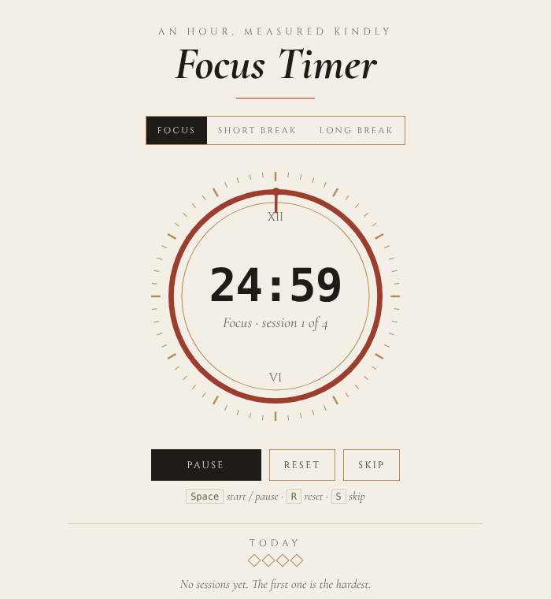

# Focus Timer

A quiet focus-and-break timer with a sundial face.

- Focus, short break and long break, with a long break every few sessions
- The dial's shadow sweeps around as time passes; the colour changes with the mode
- A soft bell when a session ends, and optional desktop notifications
- Keeps accurate time even when the tab is in the background
- Counts today's sessions and minutes of focus
- Keyboard: `Space` start / pause · `R` reset · `S` skip
- English and Turkish, light and dark theme; settings are saved in your browser

## Use it

Open `index.html` in any browser. For a link you can open anywhere, enable **GitHub Pages** (Settings → Pages → deploy from `main`).

## License

MIT
